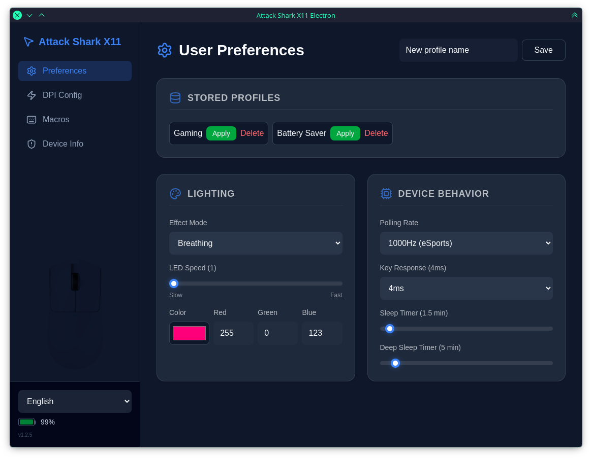

# Attack Shark X11 Community Driver



[](LICENSE)
[](https://github.com/akawazak/attack-shark-x11-community-driver/stargazers)

A community desktop app for configuring compatible gaming mice on Windows and Linux. It controls DPI stages, polling rate, lighting, sleep behavior, button mappings, macros, and wireless battery status.

## Install

Download Windows and Linux builds from the [official Releases page](https://github.com/akawazak/attack-shark-x11-community-driver/releases).

### Windows

- Use the setup executable for a normal installation.
- Use the portable executable when you do not want to install the app.
- No replacement USB driver or administrator access is required. Close another mouse-configuration app if it is already using the device.

Windows releases may be unsigned unless the project has a code-signing certificate configured. Compare the downloaded file against `SHA256SUMS` on the release before running it.

### Linux

The `.deb`, AppImage installer, and AUR package install a restricted udev rule (`0660` with `uaccess`) so the current desktop user can access supported devices without running the app as root.

To use the verified installer, download it first and check it before running it:

```bash
curl --proto '=https' --tlsv1.2 -fLO https://github.com/akawazak/attack-shark-x11-community-driver/releases/latest/download/install.sh
curl --proto '=https' --tlsv1.2 -fLO https://github.com/akawazak/attack-shark-x11-community-driver/releases/latest/download/SHA256SUMS
grep ' install.sh$' SHA256SUMS | sha256sum --check
bash install.sh
```

The installer verifies every release asset against `SHA256SUMS` before installing it. Arch users are shown their AUR helper's normal review and confirmation flow.

The default rule uses the active desktop session's `uaccess` ACL. If that is unavailable on a particular login manager, the verified installer has an explicit restricted-group fallback:

```bash
bash install.sh --group-access
```

This creates the dedicated `attackshark` group, adds only the current desktop user, and keeps device permissions at `0660`. Log out completely and sign back in before reconnecting the mouse. The installer never enables this fallback silently.

## Supported hardware

| Device | Connection | Protocol support |
| --- | --- | --- |
| Attack Shark X11 / X11 SE | USB cable and 2.4 GHz receiver | X11 |
| Attack Shark R1 | USB cable and compatible 2.4 GHz receiver | R1 or X11-compatible receiver |
| VXE R1 SE+ | X11-compatible 2.4 GHz receiver | X11-compatible |

The app connects automatically. Wired X11-family and R1 devices have distinct product IDs, so their protocol is selected directly. The wireless receiver uses the shared USB ID `1d57:fa60`; because that ID does not reveal the marketing name, the app uses the established X11-compatible wireless protocol instead of guessing a model from branding.

Known product IDs are `fa60` (2.4 GHz receiver), `fa55` (X11-family wired), and `fa61` (R1 wired). Bluetooth is not supported by this app.

## What is immediate and what is delayed

Browsing tabs, opening the app from the taskbar, editing fields, loading profiles, changing theme/language, checking battery status, and saving local app settings are immediate and do not enter the USB safety queue.

Only an explicit **Apply to mouse**, macro write, or device reset writes mouse memory. Actual USB writes are serialized and keep a 500 ms safety interval between reports. A multi-report operation can therefore take longer while the rest of the app remains responsive.

## Battery status

Wireless battery reports can occasionally contain abrupt false readings. The app:

- shows the first valid reading as provisional and confirms the median after three reports;
- requires three matching reports before accepting an increase or drop greater than five percentage points;
- marks old values as stale and keeps recent report decisions in Device Info.

Battery reporting is unavailable in wired mode because that connection does not expose the wireless receiver's battery stream. See [the protocol notes](docs/battery-status.md) for details.

If the receiver stays plugged in while the mouse is connected by USB, the wired identity takes priority and the app periodically checks for cable connection changes. Wired mode is shown as USB connected; the app does not invent a charging percentage that the device protocol does not provide.

## Updates

Packaged builds automatically check the official GitHub Releases metadata after startup. When an update exists, the app opens the exact official release page so you can verify `SHA256SUMS` and install it deliberately.

The app does not silently download or execute unsigned update files. Fully automatic installation should only be enabled after Windows and Linux release signing is configured.

## Build from source

Install [Bun 1.3.14](https://bun.sh/), then:

```bash
git clone https://github.com/akawazak/attack-shark-x11-community-driver.git
cd attack-shark-x11-community-driver
bun install --frozen-lockfile
bun run format
bun run lint
bun run typecheck
bun test
bun run package
```

Packages are written to `dist/`. Release CI verifies the exact tag on Windows and Linux, publishes SHA-256 checksums, and creates GitHub build-provenance attestations.

## Contributing

Protocol work can write persistent settings to a physical device. Keep USB reads separate from writes, validate report fields, serialize multi-report operations, and test with a known-compatible mouse before publishing. Pull requests and hardware reports are welcome.

If the driver works for your mouse, [starring the repository](https://github.com/akawazak/attack-shark-x11-community-driver) helps other owners find it.

## Credits

- [HarukaYamamoto0](https://github.com/HarukaYamamoto0) — original X11 driver and protocol research.
- [dressedinblack5](https://github.com/dressedinblack5) — Electron/Vue app, packaging, and the maintained `node-usb-rs` fork.
- [xb-bx](https://github.com/xb-bx) — Attack Shark R1 protocol work and hardware testing.
- [akawazak](https://github.com/akawazak) — community maintenance, Windows compatibility, battery work, and releases.

Licensed under [MIT](LICENSE). This project is not affiliated with Attack Shark or VXE.
